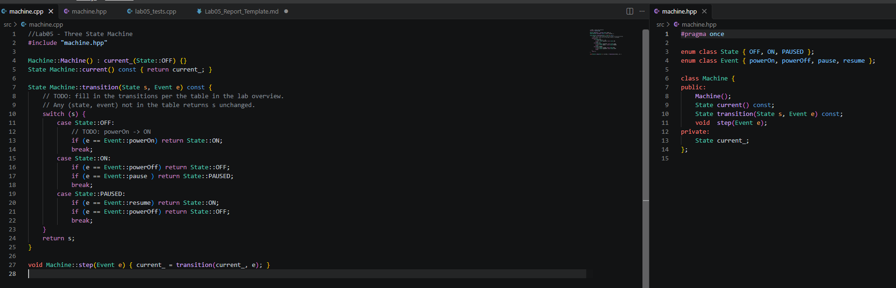
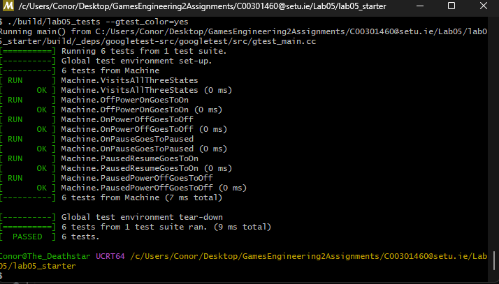

# Lab 05 — Report

**Name:** <Conor Foley>

**StudentID:** <C00301460>

## Coverage summary

State coverage:  3 / 3
Transition coverage:  5 / 5

## Report (250-500 words max)

    1. State coverage is testing wheather or not our machine has been put into the correct state without caring how it got there. Transition coverage is testing that the transition code to send the machine from one state to another is doing so correctly, eg testing that the pause event doesnt turn the machine off etc. It is possible to achieve 100% state coverage without 100% transition coverage. The test that tests all 3 states never uses the resume transition leaving all 3 states corrctly tested but this one transition not visited. 

    2. Give one example of a bug in `transition()` that would slip past state coverage but be caught by transition coverage.
        I actually coded a bug by accident, when filling in the transition switch case, if (e == Event::powerOff) return State::ON; I accidentally typed ON instead of OFF and my test case for the three states passed. It wasnt until I ran the transition tests and this test failed that I realised my mistake. Without transition coverage testing this would have gone unnoticed. 

## Screenshots
To be provided as:
* `screenshots/vscode.png`

* `screenshots/terminal.png`

