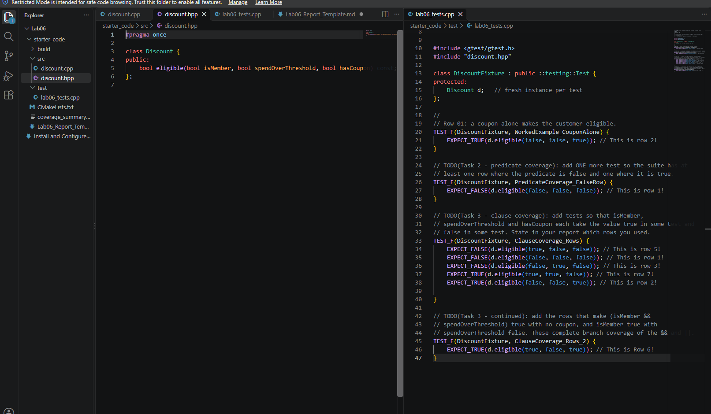
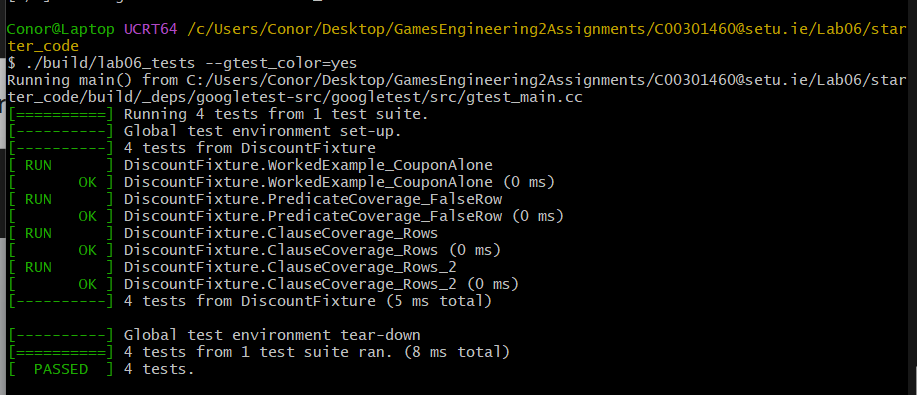

# Lab 06 — Report

**Full Name: Conor Foley** 
**Student ID: C00301460** 

## Build, test, coverage

```
cmake -S . -B build
cmake --build build --target lab06_tests
./build/lab06_tests --gtest_color=yes

cmake -S . -B build-cov -DCMAKE_CXX_FLAGS="--coverage" \
                        -DCMAKE_EXE_LINKER_FLAGS="--coverage"
cmake --build build-cov --target lab06_tests
./build-cov/lab06_tests
gcov -b -r build-cov/CMakeFiles/discount.dir/src/discount.cpp.gcno > coverage_summary.txt
```

## Coverage criteria

Predicate-coverage rows used:  1 (0,0,0) , 2 (0,0,1)
Clause-coverage rows used:  1 (0,0,0), 2 (0,0,1), 3 (0,1,0), 5 (1,0,0), 7 (1,1,0)
Tests reported / passed:  4 / 4

## Coverage summary (paste the tail of coverage_summary.txt)

```
My Summary .txt was blank which as far as I know indicates total coverage

```

## Report (250-500 words)

Predicate coverage looks to test if both true and false are reachable outcomes for the predicate but doesnt guarentee that all clauses within the predicate have been tested. Row 2 will make the predicate true and row 3 will make it false however, this doesnt satisfy clause coverage because it doesnt explore the case where A and B are true thus making the predicate true. There is an or || operator which means for the predicate to be true either A and B can be true or C can be true. The rows mentioned above only test the predicate being true in the case where C is true. 

The output for gcov was blank so this means both line and branch coverage were achieved 100%. Line coverage sets out to cover all possible Clause states, so A = true, A = False, B = True, B = False and C = true, C = False. Branch coverage means boths sides of the branching logic in the predicate are tested in both their states. Where A and B are true, the predicate is true, where C is true, the predicate is true, where A, B and C are all false, the predicate is false and lastly if only 1 of A or B is true while C is false the predicate will be false. 

## Screenshots

* `screenshots/vscode.png`

* `screenshots/terminal.png`

